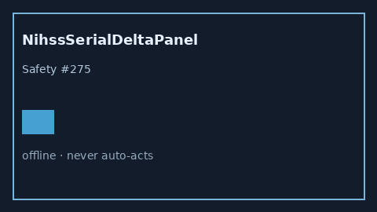

# NihssSerialDeltaPanel Guide



Research-only advisory panel (Safety #275).
Gap vs MDCalc / NIHSS serial delta-trend panel. Distinct from `NihssStrokeScorer` / `GcsNeurologicStatusScorer`.

Stack: **GPT-5.5 / Claude Sonnet 4.6 / Gemini 3.x / Kimi K2**.

## Usage

```python
from medagent.safety.nihss_serial_delta_panel import (
    NihssSerialDeltaFactors,
    NihssSerialDeltaPanel,
)

findings = NihssSerialDeltaPanel().check(NihssSerialDeltaFactors())
print(findings[0].band, findings[0].rationale)
```

## Safety

RESEARCH USE ONLY. Never modifies medications. No network I/O.
