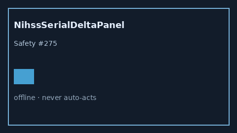

# NihssSerialDeltaPanel Guide



Research-only advisory panel (Safety #275).
Gap vs MDCalc / NIHSS serial delta-trend panel. Distinct from `NihssStrokeScorer` / `GcsNeurologicStatusScorer`.

Stack: **GPT-6 Astra / Claude Opus 5.5 / Gemini 4 Argon / Kimi K3.1 Pro**.

## Usage

```python
from medagent.safety.nihss_serial_delta_panel import (
    NihssSerialDeltaFactors,
    NihssSerialDeltaPanel,
)

findings = NihssSerialDeltaPanel().check(NihssSerialDeltaFactors())
print(findings[0].band, findings[0].rationale)
```

## Safety

RESEARCH USE ONLY. Never modifies medications. No network I/O.
