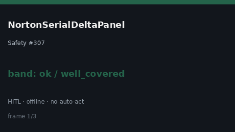

# NortonSerialDeltaPanel Guide



Research-only Safety #307 serial delta panel.
Offline helper.
Gap vs MDCalc / Norton pressure-ulcer serial delta-trend panel. Distinct from `BradenSerialDeltaPanel` / `WaterlowSerialDeltaPanel`.

Stack: **GPT-6 Astra / Claude Opus 5.5 / Gemini 4 Argon / Kimi K3.1 Pro**.

## Usage

```python
from medagent.safety.norton_serial_delta_panel import (
    NortonSerialDeltaFactors,
    NortonSerialDeltaPanel,
)

findings = NortonSerialDeltaPanel().check(NortonSerialDeltaFactors())
print(findings[0].band, findings[0].rationale)
```

## Safety

RESEARCH USE ONLY. Never modifies medications. See `SAFETY.md` #307.
