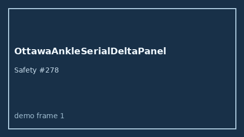

# OttawaAnkleSerialDeltaPanel Guide



Research-only Safety #278.
Gap vs MDCalc / Ottawa Ankle serial delta-trend panel. Distinct from `OttawaAnkleRuleScorer` / `OttawaKneeRuleScorer`.

Stack: **GPT-5.5 / Claude Sonnet 4.6 / Gemini 3.x / Kimi K2**.

## Usage

```python
from medagent.safety.ottawa_ankle_serial_delta_panel import (
    OttawaAnkleSerialDeltaFactors,
    OttawaAnkleSerialDeltaPanel,
)

findings = OttawaAnkleSerialDeltaPanel().check(OttawaAnkleSerialDeltaFactors())
print(findings[0].band, findings[0].rationale)
```

## Safety

RESEARCH USE ONLY. Advisory. Never modifies medications. No network I/O.
