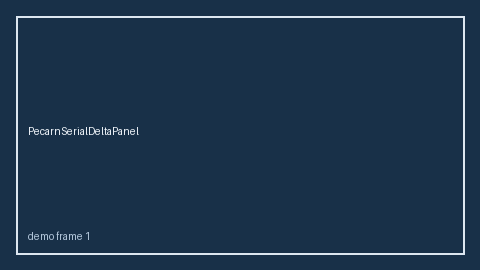

# OttawaSahSerialDeltaPanel Guide



Research-only serial delta panel (Safety #286).
Gap vs MDCalc / Ottawa SAH Rule serial delta-trend panel. Distinct from `OttawaSahRuleScorer` / `HuntHessSahScorer`.

Stack: **GPT-6 Astra / Claude Opus 5.5 / Gemini 4 Argon / Kimi K3.1 Pro**.

## Usage

```python
from medagent.safety.ottawa_sah_serial_delta_panel import (
    OttawaSahSerialDeltaFactors,
    OttawaSahSerialDeltaPanel,
)

findings = OttawaSahSerialDeltaPanel().check(OttawaSahSerialDeltaFactors())
print(findings[0].band, findings[0].rationale)
```

## Safety

RESEARCH USE ONLY. Advisory. Never modifies medications. No network I/O.
