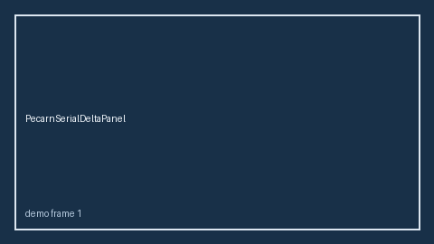

# PecarnSerialDeltaPanel Guide



Research-only serial delta panel (Safety #284).
Gap vs MDCalc / PECARN pediatric head trauma serial delta-trend panel. Distinct from `PecarnHeadTraumaScorer` / `CanadianCtHeadSerialDeltaPanel`.

Stack: **GPT-6 Astra / Claude Opus 5.5 / Gemini 4 Argon / Kimi K3.1 Pro**.

## Usage

```python
from medagent.safety.pecarn_serial_delta_panel import (
    PecarnSerialDeltaFactors,
    PecarnSerialDeltaPanel,
)

findings = PecarnSerialDeltaPanel().check(PecarnSerialDeltaFactors())
print(findings[0].band, findings[0].rationale)
```

## Safety

RESEARCH USE ONLY. Advisory. No network I/O. Never modifies medications.
