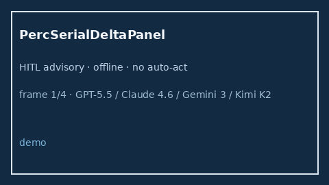

# PercSerialDeltaPanel Guide



Research-only advisory panel (Safety #268).
Gap vs MDCalc / PERC serial delta-trend panel. Distinct from `PercPeExclusionScorer` / `WellsPeSerialDeltaPanel`.

Stack: **GPT-5.5 / Claude Sonnet 4.6 / Gemini 3.x / Kimi K2**.

## Usage

```python
from medagent.safety.perc_serial_delta_panel import (
    PercSerialDeltaFactors,
    PercSerialDeltaPanel,
)

findings = PercSerialDeltaPanel().check(PercSerialDeltaFactors())
print(findings[0].band, findings[0].rationale)
```

## Safety

RESEARCH USE ONLY. Never modifies medications. No network I/O.
