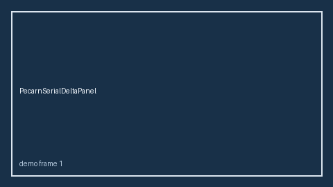

# PesiSerialDeltaPanel Guide



Research-only serial delta panel (Safety #287).
Gap vs MDCalc / PESI PE severity serial delta-trend panel. Distinct from `PesiPeSeverityScorer` / `WellsPeSerialDeltaPanel`.

Stack: **GPT-6 Astra / Claude Opus 5.5 / Gemini 4 Argon / Kimi K3.1 Pro**.

## Usage

```python
from medagent.safety.pesi_serial_delta_panel import (
    PesiSerialDeltaFactors,
    PesiSerialDeltaPanel,
)

findings = PesiSerialDeltaPanel().check(PesiSerialDeltaFactors())
print(findings[0].band, findings[0].rationale)
```

## Safety

RESEARCH USE ONLY. Advisory. Never modifies medications. No network I/O.
