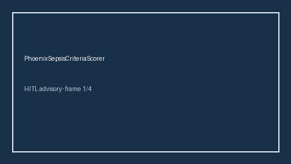

# PhoenixSepsisCriteriaScorer Guide



Research-only advisory scorer. Never modifies medications. Gap vs MDCalc / SCCM Phoenix sepsis criteria.

Optional narrative via **GPT-5.5 / Claude Sonnet 4.6 / Gemini 3.x / Kimi K2**.

Distinct from `SirsCriteriaScorer / QSofaSepsisScreenScorer`.

## Usage

```python
from medagent.safety.phoenix_sepsis_criteria_scorer import (
    PhoenixSepsisCriteriaFactors,
    PhoenixSepsisCriteriaScorer,
)

findings = PhoenixSepsisCriteriaScorer().check(PhoenixSepsisCriteriaFactors())
print(findings[0].band, findings[0].rationale)
```
