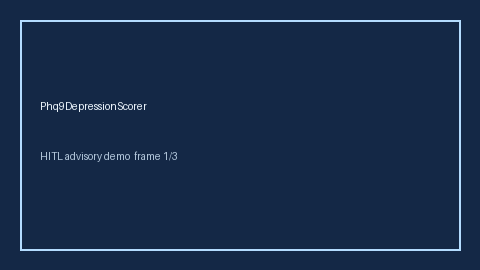

# Phq9DepressionScorer Guide



Research-only advisory scorer. Gap vs MDCalc / USPSTF PHQ-9 depression severity screen. Distinct from `EpworthSleepinessScorer` / `StopBangOsaScorer`.

Optional narrative via **GPT-5.5 / Claude Sonnet 4.6 / Gemini 3.x / Kimi K2**.

## Usage

```python
from medagent.safety.phq9_depression_scorer import (
    Phq9DepressionFactors,
    Phq9DepressionScorer,
)

findings = Phq9DepressionScorer().check(Phq9DepressionFactors())
print(findings[0].band)
```

## Safety

RESEARCH USE ONLY. Never modifies medications. See `SAFETY.md` #240.
