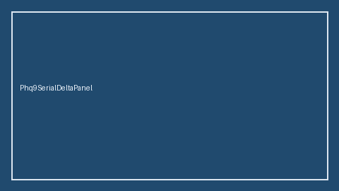

# Phq9SerialDeltaPanel Guide



Research-only Safety #304 serial delta panel.
Offline helper.
Gap vs MDCalc / PHQ-9 depression serial delta-trend panel. Distinct from `Phq9DepressionScorer` / `Gad7AnxietyScorer`.

Stack: **GPT-5.5 / Claude Sonnet 4.6 / Gemini 3.x / Kimi K2**.

## Usage

```python
from medagent.safety.phq9_serial_delta_panel import (
    Phq9SerialDeltaFactors,
    Phq9SerialDeltaPanel,
)

findings = Phq9SerialDeltaPanel().check(Phq9SerialDeltaFactors())
print(findings[0].band, findings[0].rationale)
```

## Safety

Advisory only. No network I/O. Never auto-acts. Humans decide.
