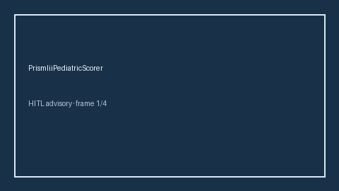

# PrismIiiPediatricScorer Guide



Research-only advisory scorer. Never modifies medications. Gap vs MDCalc / PICU PRISM III pediatric ICU score.

Optional narrative via **GPT-5.5 / Claude Sonnet 4.6 / Gemini 3.x / Kimi K2**.

Distinct from `PewsEarlyWarningScorer / ApacheIiLiteScorer`.

## Usage

```python
from medagent.safety.prism_iii_pediatric_scorer import (
    PrismIiiPediatricFactors,
    PrismIiiPediatricScorer,
)

findings = PrismIiiPediatricScorer().check(PrismIiiPediatricFactors())
print(findings[0].band, findings[0].rationale)
```
