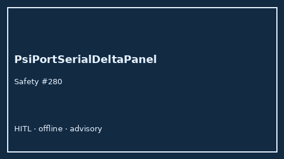

# PsiPortSerialDeltaPanel Guide



Research-only Safety #280 serial delta panel.
Gap vs MDCalc / PSI/PORT serial delta-trend panel. Distinct from `PsiPortPneumoniaScorer` / `Curb65SerialDeltaPanel`.

Stack: **GPT-5.5 / Claude Sonnet 4.6 / Gemini 3.x / Kimi K2**.

## Usage

```python
from medagent.safety.psi_port_serial_delta_panel import (
    PsiPortSerialDeltaFactors,
    PsiPortSerialDeltaPanel,
)

findings = PsiPortSerialDeltaPanel().check(PsiPortSerialDeltaFactors())
print(findings[0].band)
```

## Safety

RESEARCH USE ONLY. Never modifies medications. No network I/O.
