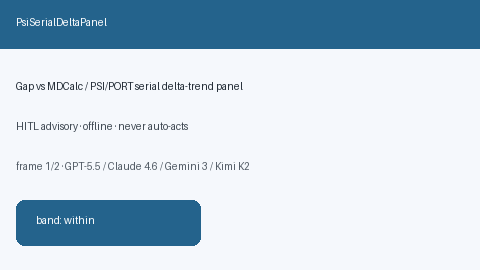

# PsiSerialDeltaPanel Guide



Research-only advisory panel. Gap vs MDCalc / PSI/PORT serial delta-trend panel.
Distinct from `PsiPortPneumoniaScorer` / `Curb65SerialDeltaPanel`.

Narrative polish via **GPT-6 Astra / Claude Opus 5.5 / Gemini 4 Argon / Kimi K3.1 Pro**.

## Usage

```python
from medagent.safety.psi_serial_delta_panel import PsiSerialDeltaFactors, PsiSerialDeltaPanel

findings = PsiSerialDeltaPanel().check(PsiSerialDeltaFactors())
assert findings[0].rationale
```

## Safety

RESEARCH USE ONLY. Advisory. Never modifies medications. No network I/O.
