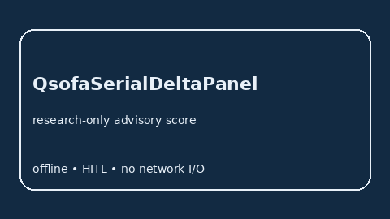

# QsofaSerialDeltaPanel Guide



Research-only advisory serial-delta panel. Gap vs MDCalc / qSOFA serial delta-trend panel.
Distinct from `QSofaSepsisScreenScorer` / `News2SerialDeltaPanel`.

Optional narrative via **GPT-5.5 / Claude Sonnet 4.6 / Gemini 3.x / Kimi K2**.

## Usage

```python
from medagent.safety.qsofa_serial_delta_panel import (
    QsofaSerialDeltaFactors,
    QsofaSerialDeltaPanel,
)

findings = QsofaSerialDeltaPanel().check(
    QsofaSerialDeltaFactors(prior_qsofa_elevated=1, current_qsofa_rise=1)
)
assert findings[0].rationale
print(findings[0].band, findings[0].score)
```

## Safety

RESEARCH USE ONLY. Advisory score. Never modifies medications. No network I/O.
