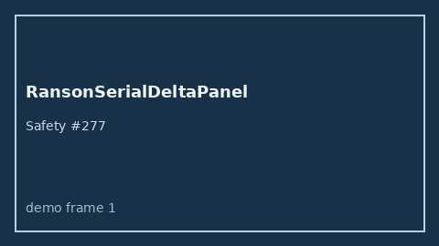

# RansonSerialDeltaPanel Guide



Research-only Safety #277.
Gap vs MDCalc / Ranson serial delta-trend panel. Distinct from `RansonPancreatitisScorer` / `BisapPancreatitisScorer`.

Stack: **GPT-6 Astra / Claude Opus 5.5 / Gemini 4 Argon / Kimi K3.1 Pro**.

## Usage

```python
from medagent.safety.ranson_serial_delta_panel import (
    RansonSerialDeltaFactors,
    RansonSerialDeltaPanel,
)

findings = RansonSerialDeltaPanel().check(RansonSerialDeltaFactors())
print(findings[0].band, findings[0].rationale)
```

## Safety

RESEARCH USE ONLY. Advisory. Never modifies medications. No network I/O.
