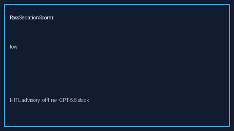

# RassSedationScorer Guide



Research-only advisory scorer. Gap vs MDCalc / SCCM Richmond Agitation-Sedation Scale (RASS) screen.
Distinct from `CamIcuDeliriumScorer` / `CiwaArWithdrawalScorer`. Safety #247.

Narrative polish via **GPT-5.5 / Claude Sonnet 4.6 / Gemini 3.x / Kimi K2**.

## Usage

```python
from medagent.safety.rass_sedation_scorer import RassSedationFactors, RassSedationScorer

findings = RassSedationScorer().check(RassSedationFactors())
print(findings[0].band, findings[0].rationale)
```

## Safety

RESEARCH USE ONLY. Never modifies medications. No network I/O.
