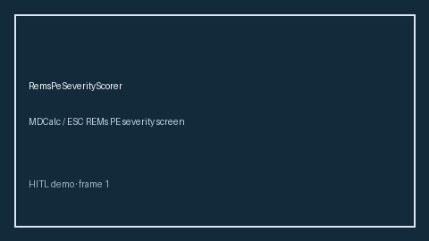

# RemsPeSeverityScorer Guide



Research-only advisory scorer. Gap vs MDCalc / ESC REMs PE severity screen. Distinct from `PesiPeSeverityScorer` / `WellsPeProbabilityScorer`.

Optional narrative via **GPT-5.5 / Claude Sonnet 4.6 / Gemini 3.x / Kimi K2**.

## Usage

```python
from medagent.safety.rems_pe_severity_scorer import (
    RemsPeSeverityFactors,
    RemsPeSeverityScorer,
)

findings = RemsPeSeverityScorer().check(RemsPeSeverityFactors())
print(findings[0].band)
```

## Safety

RESEARCH USE ONLY. Never modifies medications. See `SAFETY.md` #236.
