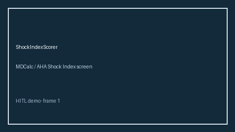

# ShockIndexScorer Guide



Research-only advisory scorer. Gap vs MDCalc / AHA Shock Index screen. Distinct from `QsofaSepsisScreenScorer` / `PhoenixSepsisCriteriaScorer`.

Optional narrative via **GPT-5.5 / Claude Sonnet 4.6 / Gemini 3.x / Kimi K2**.

## Usage

```python
from medagent.safety.shock_index_scorer import (
    ShockIndexFactors,
    ShockIndexScorer,
)

findings = ShockIndexScorer().check(ShockIndexFactors())
print(findings[0].band)
```

## Safety

RESEARCH USE ONLY. Never modifies medications. See `SAFETY.md` #235.
