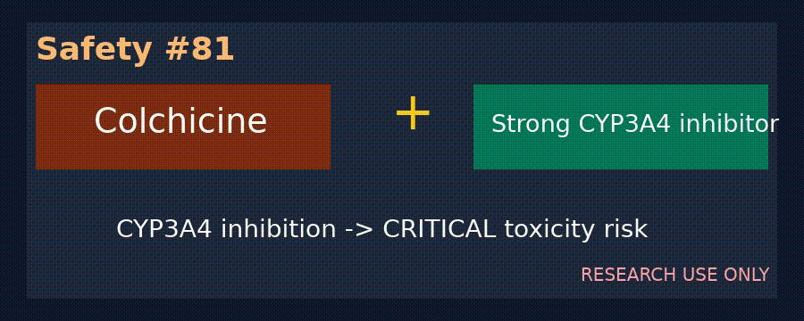

# Simvastatin + Amiodarone Myopathy/Rhabdomyolysis Checker

*medagent-core — Safety Control #107*



## Overview

`SimvastatinAmiodaroneChecker` flags simvastatin amiodarone co-prescription risks.
Amiodarone inhibits CYP3A4-mediated simvastatin metabolism, increasing statin
exposure and myopathy/rhabdomyolysis risk (FDA dose-limit warning).

Findings are advisory `SimvastatinAmiodaroneRisk` records — **RESEARCH USE ONLY**.
Distinct from statin_fibrate and digoxin_amio interaction checkers.

## Medication panels

| Class | Agents | Severity |
|---|---|---|
| Primary | `simvastatin` | — |
| Primary | `zocor` | — |
| Partner | `amiodarone` | `CRITICAL` |
| Partner | `cordarone` | `CRITICAL` |

## Quick start

```python
from medagent.models import Medication
from medagent.safety import SimvastatinAmiodaroneChecker

findings = SimvastatinAmiodaroneChecker().check(
    [Medication(name="simvastatin"), Medication(name="amiodarone")]
)
```

## Reasoning stack notes

Prefer **GPT-6 Astra**, **Claude Opus 5.5**, **Gemini 4 Argon**, **Kimi K3.1 Pro**.

## See also

- [SAFETY.md §3.107](../../SAFETY.md)
