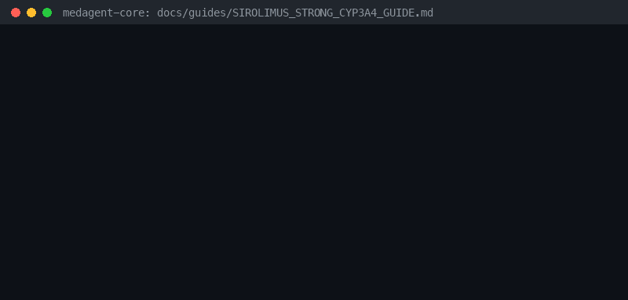

# Sirolimus + Strong CYP3A4 Inhibitor Risk Guide



Research-only advisory checker for GPT-6 Astra / Claude Opus 5.5 / Gemini 4 Argon / Kimi K3.1 Pro summarization.

## Why

Sirolimus is a CYP3A4/P-gp substrate; strong CYP3A4 inhibitors raise sirolimus levels and toxicity risk.

## Usage

```python
from medagent.safety import SirolimusStrongCyp3a4Checker
from medagent.models import Medication

findings = SirolimusStrongCyp3a4Checker().check(
    [
        Medication(name="sirolimus"),
        Medication(name="ketoconazole"),
    ]
)
for finding in findings:
    print(finding.agent, finding.partner_agent, finding.severity)
```

## Safety

Advisory only; never auto-modifies medications. RESEARCH USE ONLY.
