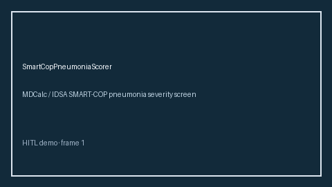

# SmartCopPneumoniaScorer Guide



Research-only advisory scorer. Gap vs MDCalc / IDSA SMART-COP pneumonia severity screen. Distinct from `Curb65PneumoniaScorer` / `PsiPortPneumoniaScorer`.

Optional narrative via **GPT-5.5 / Claude Sonnet 4.6 / Gemini 3.x / Kimi K2**.

## Usage

```python
from medagent.safety.smart_cop_pneumonia_scorer import (
    SmartCopPneumoniaFactors,
    SmartCopPneumoniaScorer,
)

findings = SmartCopPneumoniaScorer().check(SmartCopPneumoniaFactors())
print(findings[0].band)
```

## Safety

RESEARCH USE ONLY. Never modifies medications. See `SAFETY.md` #237.
