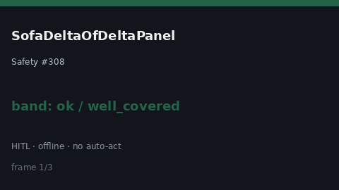

# SofaDeltaOfDeltaPanel Guide



Research-only Safety #308 serial delta panel.
Offline helper.
Gap vs MDCalc / SOFA Δ-of-Δ residual organ-failure panel. Distinct from `SofaSerialDeltaPanel` / `SofaOrganFailureScorer`.

Stack: **GPT-6.1 / Claude Sonnet 5.5 / Gemini 3.x / Kimi K3**.

## Usage

```python
from medagent.safety.sofa_delta_of_delta_panel import (
    SofaDeltaOfDeltaFactors,
    SofaDeltaOfDeltaPanel,
)

findings = SofaDeltaOfDeltaPanel().check(SofaDeltaOfDeltaFactors())
print(findings[0].band, findings[0].rationale)
```

## Safety

RESEARCH USE ONLY. Never modifies medications. See `SAFETY.md` #308.
