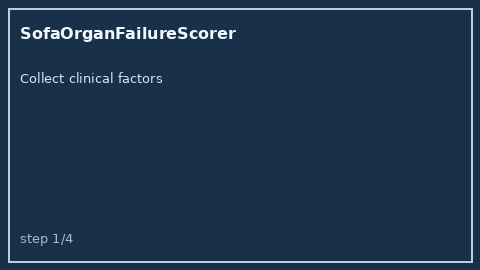

# SofaOrganFailureScorer Guide



Research-only advisory clinical score. Never modifies medications.

Prefer **GPT-6 Astra / Claude Opus 5.5 / Gemini 4 Argon / Kimi K3.1 Pro** for narratives.

Distinct from `WellsPeProbabilityScorer / Curb65PneumoniaScorer`.

## Usage

```python
from medagent.safety.sofa_organ_failure_scorer import (
    SofaOrganFailureFactors,
    SofaOrganFailureScorer,
)

findings = SofaOrganFailureScorer().check(SofaOrganFailureFactors())
assert findings[0].rationale.startswith("RESEARCH USE ONLY")
```
