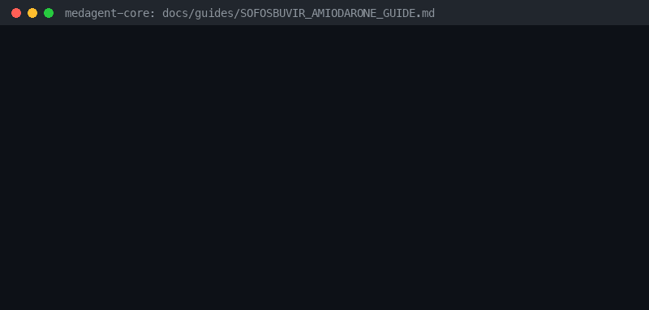

# Sofosbuvir + Amiodarone Bradycardia Risk Guide



Research-only advisory checker for GPT-6 Astra / Claude Opus 5.5 / Gemini 4 Argon / Kimi K3.1 Pro summarization.

## Why

Coadministration of sofosbuvir-containing HCV regimens with amiodarone can cause serious symptomatic bradycardia.

## Usage

```python
from medagent.safety import SofosbuvirAmiodaroneChecker
from medagent.models import Medication

findings = SofosbuvirAmiodaroneChecker().check(
    [
        Medication(name="sofosbuvir"),
        Medication(name="amiodarone"),
    ]
)
for finding in findings:
    print(finding.agent, finding.partner_agent, finding.severity)
```

## Safety

Advisory only; never auto-modifies medications. RESEARCH USE ONLY.
