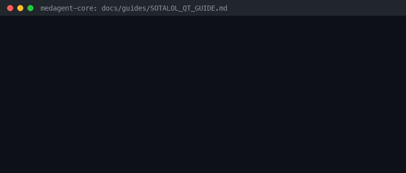

# Sotalol QT-Prolongation Checker

*medagent-core — Safety Control #110*



## Overview

`SotalolQtChecker` flags sotalol therapy (sotalol, Betapace, Betapace AF, Sorine, Sotylize) as a brand-aware QT-risk finding. Sotalol alone is `HIGH`; co-prescription with other known QT-prolonging agents (ondansetron/Zofran, levofloxacin/Levaquin, haloperidol/Haldol, amiodarone/Cordarone — `CRITICAL`; azithromycin/Zithromax — `HIGH`) escalates torsades de pointes concern.

Findings are advisory `SotalolQtRisk` records — **RESEARCH USE ONLY**.
Distinct from the general multi-drug QT-prolongation screen and electrolyte QT checkers.

## Medication panels

| Class | Agents | Severity |
|---|---|---|
| Primary | `sotalol`, `betapace`, `betapace af`, `sorine`, `sotylize` | `HIGH` alone |
| Partner | `ondansetron`, `zofran`, `levofloxacin`, `levaquin`, `haloperidol`, `haldol`, `amiodarone`, `cordarone` | `CRITICAL` |
| Partner | `azithromycin`, `zithromax` | `HIGH` |

## Quick start

```python
from medagent.models import Medication
from medagent.safety import SotalolQtChecker

findings = SotalolQtChecker().check([Medication(name="sotalol"), Medication(name="ondansetron")])
for finding in findings:
    print(finding.agent, finding.partner_agent, finding.severity)
```

## Reasoning stack notes

Prefer **GPT-6 Astra**, **Claude Opus 5.5**, **Gemini 4 Argon**, **Kimi K3.1 Pro**.

## See also

- [SAFETY.md §3.110](../../SAFETY.md)
