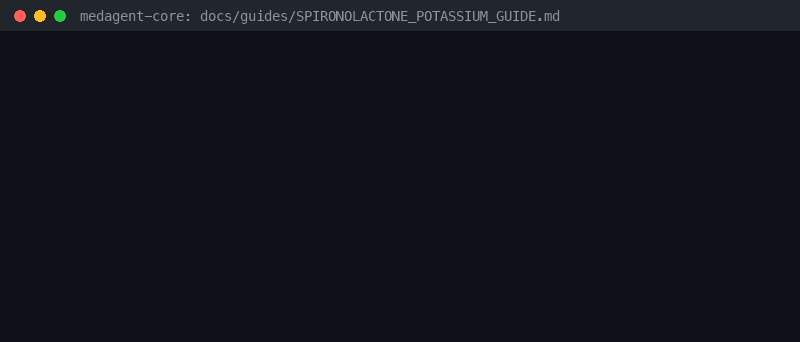

# Spironolactone / Eplerenone + Potassium Hyperkalemia Checker

*medagent-core — Safety Control #112*



## Overview

`SpironolactonePotassiumChecker` flags mineralocorticoid receptor antagonists (spironolactone/Aldactone, eplerenone/Inspra) co-prescribed with potassium supplements (potassium chloride/KCl/Klor-Con/potassium — `CRITICAL`) or potassium-containing salt substitutes (salt substitute/NoSalt — `HIGH`). MRA therapy plus exogenous potassium intensifies hyperkalemia risk.

Findings are advisory `SpironolactonePotassiumRisk` records — **RESEARCH USE ONLY**.
Distinct from ACEI/ARB + potassium and ACEI/ARB + potassium-sparing diuretic checkers.

## Medication panels

| Class | Agents | Severity |
|---|---|---|
| Primary | `spironolactone`, `aldactone`, `eplerenone`, `inspra` | — |
| Partner | `potassium-chloride`, `kcl`, `klor-con`, `potassium` | `CRITICAL` |
| Partner | `salt-substitute`, `no-salt`, `nosalt` | `HIGH` |

## Quick start

```python
from medagent.models import Medication
from medagent.safety import SpironolactonePotassiumChecker

findings = SpironolactonePotassiumChecker().check(
    [Medication(name="spironolactone"), Medication(name="potassium chloride")]
)
```

## Reasoning stack notes

Prefer **GPT-6 Astra**, **Claude Opus 5.5**, **Gemini 4 Argon**, **Kimi K3.1 Pro**.

## See also

- [SAFETY.md §3.112](../../SAFETY.md)
