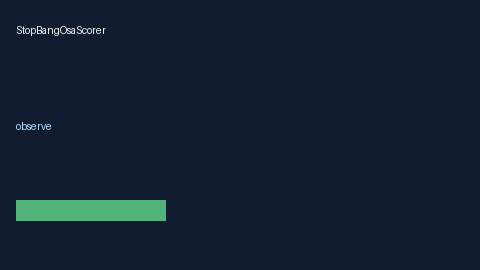

# StopBangOsaScorer Guide



Research-only advisory scorer. Never modifies medications. Gap vs MDCalc / ASA STOP-BANG OSA screen.

Optional narrative via **GPT-5.5 / Claude Sonnet 4.6 / Gemini 3.x / Kimi K2**.

Distinct from `EpworthSleepiness / MallampatiAirwayScorer`.

## Usage

```python
from medagent.safety.stop_bang_osa_scorer import (
    StopBangOsaFactors,
    StopBangOsaScorer,
)

findings = StopBangOsaScorer().check(StopBangOsaFactors())
print(findings[0].band, findings[0].rationale)
```
