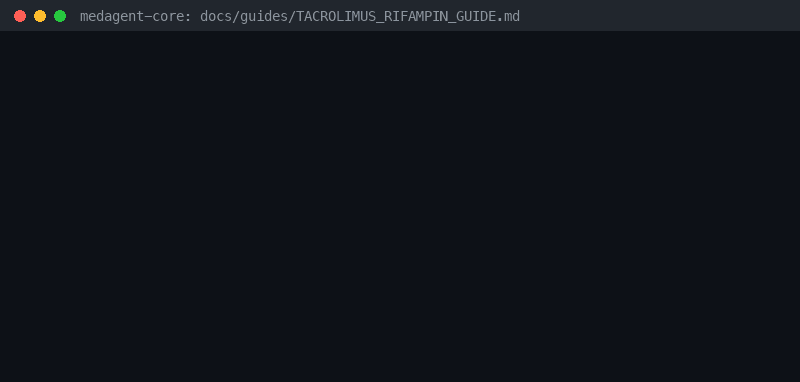

# Tacrolimus + Rifampin Induction Risk Guide



Research-only advisory checker for GPT-6 Astra / Claude Opus 5.5 / Gemini 4 Argon / Kimi K3.1 Pro summarization.

## Why

Rifampin strongly induces CYP3A4, markedly reducing tacrolimus exposure and raising transplant rejection risk.

## Usage

```python
from medagent.safety import TacrolimusRifampinChecker
from medagent.models import Medication

findings = TacrolimusRifampinChecker().check(
    [
        Medication(name="tacrolimus"),
        Medication(name="rifampin"),
    ]
)
for finding in findings:
    print(finding.agent, finding.partner_agent, finding.severity)
```

## Safety

Advisory only; never auto-modifies medications. RESEARCH USE ONLY.
