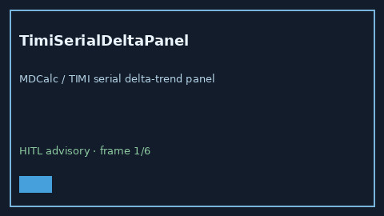

# TimiSerialDeltaPanel Guide



Research-only advisory panel (Safety #267).
Gap vs MDCalc / TIMI serial delta-trend panel. Distinct from `TimiUaNstemiScorer` / `HeartSerialDeltaPanel`.

Stack: **GPT-5.5 / Claude Sonnet 4.6 / Gemini 3.x / Kimi K2**.

## Usage

```python
from medagent.safety.timi_serial_delta_panel import TimiSerialDeltaFactors, TimiSerialDeltaPanel

findings = TimiSerialDeltaPanel().check(
    TimiSerialDeltaFactors(
        prior_timi_elevated=0,
        current_timi_rise=0,
    )
)
assert findings[0].rationale
```

## Safety

RESEARCH USE ONLY. Advisory only. No network I/O. Never modifies medications.
