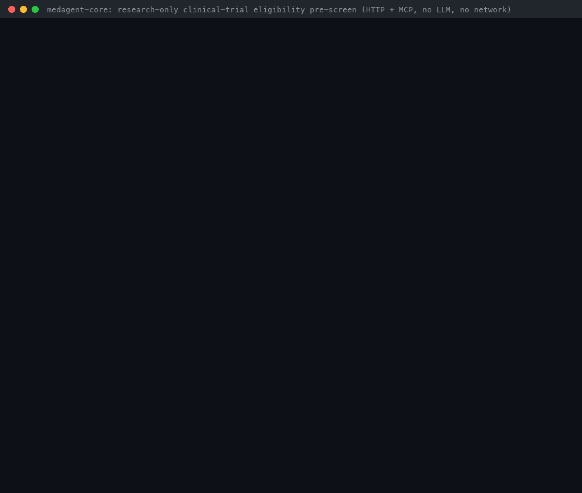
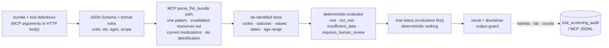

# Clinical-Trial Eligibility Pre-Screening Guide

*medagent-core — research-only, criterion-level trial pre-screening of one FHIR R4 patient, over MCP
and HTTP*



> **⚠️ RESEARCH USE ONLY — NOT FDA-cleared — NOT for clinical deployment.** This is a research
> pre-screen, never an eligibility determination: it does not enroll, contact or refer anyone, and
> every result carries the mandatory disclaimer. A study team must verify every criterion against
> the full protocol and the patient's chart. Free-text criteria are never interpreted.

`screen_trial_eligibility` (MCP) and `POST /trials/eligibility` (HTTP) evaluate one patient's FHIR R4
Bundle against 1–20 structured trial definitions. Each criterion comes back as `met`, `not_met`,
`insufficient_data` or `requires_human_review`, with a rationale and evidence pointers (resource
type, code, value, date — never an identifier). Each trial gets a status — `potentially_eligible`,
`needs_review` or `likely_ineligible` — and a deterministic, explained rank. No LLM, FHIR server or
network is ever called, and the bundle goes through the same de-identification path as the MCP
`parse_fhir_bundle` tool.

## Contents

- [What, why and who](#what-why-and-who)
- [Quickstart (offline)](#quickstart-offline)
- [Trial definition format 1.0](#trial-definition-format-10)
- [Results reference](#results-reference)
- [HTTP reference: `POST /trials/eligibility`](#http-reference-post-trialseligibility)
- [MCP reference: `screen_trial_eligibility`](#mcp-reference-screen_trial_eligibility)
- [How it works](#how-it-works)
- [Audit trail](#audit-trail)
- [Safety, privacy and limits](#safety-privacy-and-limits)
- [Configuration](#configuration)
- [Troubleshooting](#troubleshooting)
- [How this demo was recorded](#how-this-demo-was-recorded)

## What, why and who

**What.** A deterministic evaluator for trial pre-screening: you supply structured trial
definitions — the ClinicalTrials.gov `eligibilityModule` fields plus structured inclusion and
exclusion criteria (conditions, current medications, lab thresholds, pregnancy, lactation) — and one
patient's FHIR R4 Bundle. You get a criterion-by-criterion trace and a ranked list of trials.

**Who.** Clinical-research informatics teams prototyping pre-screening workflows, health-AI
engineers who need an explainable, reproducible baseline (or guardrail) for LLM trial matchers, and
MCP host users (Claude Desktop, Claude Code, Cursor, VS Code) who want an agent to pre-screen a
synthetic or de-identified record without sending it anywhere.

**Why — the gap.**

- [NIH TrialGPT](https://github.com/ncbi-nlp/TrialGPT) ([Jin et al., *Nature Communications*
  15, 9074 (2024)](https://www.nature.com/articles/s41467-024-53081-z)) showed that criterion-level
  patient-to-trial matching is the right unit of explanation: TrialGPT-Retrieval filters trials,
  TrialGPT-Matching labels each criterion (`included` / `not included` / `not enough information` /
  `not applicable`, or `excluded` / `not excluded` for exclusions) and TrialGPT-Ranking aggregates
  the labels into trial scores, with a reported 87.3% criterion-level accuracy. It needs a hosted
  LLM (its README uses Azure OpenAI) and free-text patient notes, and its matching prompt tells the
  model it may assume an unmentioned, medically important fact is not true.
- The [ClinicalTrials.gov API v2](https://clinicaltrials.gov/data-api/api) publishes a structured
  `protocolSection.eligibilityModule` — `sex` (`FEMALE`/`MALE`/`ALL`), `minimumAge` and
  `maximumAge` as `NormalizedTime` strings such as `18 Years` or `28 Days`, `healthyVolunteers`,
  `stdAges`, `genderBased` — but the inclusion and exclusion criteria themselves are one free-text
  `eligibilityCriteria` markup field.
- [OHDSI ATLAS](https://github.com/OHDSI/Atlas) defines cohorts as structured inclusion rules over
  an OMOP CDM database, and [Criteria2Query](https://github.com/OHDSI/Criteria2Query) (Yuan et al.,
  *JAMIA* 2019) parses free-text criteria into such cohort definitions. Both answer "which patients
  in this database match", not "how does this one patient's record fare against these trials".
- medagent-core had no trial matching at all.

**Gap closed.** A per-patient, offline, deterministic pre-screen with criterion-level traces that
runs on a FHIR R4 Bundle, reuses medagent's de-identification and audit conventions, exposes the
same evaluator over MCP and HTTP, and never guesses: absent data is `insufficient_data`, free text
is `requires_human_review`.

| | medagent-core trial pre-screen | [TrialGPT](https://github.com/ncbi-nlp/TrialGPT) | [Criteria2Query](https://github.com/OHDSI/Criteria2Query) / [ATLAS](https://github.com/OHDSI/Atlas) | ClinicalTrials.gov search |
| --- | --- | --- | --- | --- |
| Unit of work | One FHIR patient × 1–20 trials | One patient note × candidate trials | A cohort query over an OMOP database | Keyword/structured search for trials |
| Criteria input | Structured format 1.0 (eligibilityModule + typed criteria); free text kept for humans | Free-text criteria | Free text → OMOP concept sets and rules | `eligibilityModule` + free text |
| Decision logic | Deterministic rules with explicit closed-world limits | LLM per criterion, LLM aggregation | SQL over the CDM | None (search only) |
| Free-text criteria | Never interpreted: `requires_human_review` | Interpreted by the LLM | Parsed by NLP | Shown as text |
| Missing data | `insufficient_data` (absence counts only when the record documents the domain) | Prompt allows assuming unmentioned facts are false | Depends on the query | — |
| Evidence | Resource type, code, value, unit, date per criterion | Sentence ids from the note | Cohort counts | — |
| Network / keys | None | Hosted LLM API | Database server | Public website / API |
| Status | Research use only | Research code | Research tools | Public registry |

## Quickstart (offline)

Python 3.10+, no API keys, no network. The patient
([`examples/trials/patient-bundle.json`](../../examples/trials/patient-bundle.json)) and the four
trials ([`examples/trials/example-trials.json`](../../examples/trials/example-trials.json)) are
synthetic: a 65-year-old with stage IV non-small cell lung cancer, type 2 diabetes, hypertension
and atrial fibrillation on apixaban, metformin and lisinopril, and fictional trials with
`EXAMPLE-*` ids (never real NCT numbers).

```bash
git clone https://github.com/Francis1998/medagent-core && cd medagent-core
pip install -e .                                   # or: uv pip install -e .
```

**Python API.** Run from the repository root (`PYTHONPATH=src python example.py` without an
install):

```python
import json
from pathlib import Path

from medagent.logging_config import configure_logging
from medagent.trials.screening import screen_trials

configure_logging("WARNING")
examples = Path("examples/trials")
bundle = json.loads((examples / "patient-bundle.json").read_text(encoding="utf-8"))
trials = json.loads((examples / "example-trials.json").read_text(encoding="utf-8"))

result = screen_trials(bundle, trials, as_of="2026-11-12").structured()
for trial in result["trials"]:
    print(f"#{trial['rank']} {trial['trial_id']}  {trial['rank_reason']}")
    criteria = {item["criterion_id"]: item for item in trial["criteria"]}
    for role in ("blocking", "open"):
        for criterion_id in trial[f"{role}_criteria"]:
            criterion = criteria[criterion_id]
            print(f"    {role:<8} {criterion_id}: {criterion['section']} {criterion['status']}")
print(result["disclaimer"])
```

Real output:

```text
#1 EXAMPLE-ENDO-004  potentially_eligible: 0 blocking, 6 of 6 criteria favourable, 0 open
#2 EXAMPLE-ONC-001  needs_review: 0 blocking, 7 of 8 criteria favourable, 1 open
    open     exc-breastfeeding: exclusion insufficient_data
#3 EXAMPLE-CARD-002  needs_review: 0 blocking, 5 of 7 criteria favourable, 2 open
    open     inc-lvef: inclusion insufficient_data
    open     exc-device: exclusion requires_human_review
#4 EXAMPLE-RHEU-003  likely_ineligible: 3 blocking, 2 of 5 criteria favourable, 0 open
    blocking exc-anticoagulant: exclusion met
    blocking eligibility.maximum_age: inclusion not_met
    blocking inc-knee-oa: inclusion not_met
⚠️  RESEARCH USE ONLY. This output is generated by an AI system and has NOT been reviewed by a licensed clinician. It is NOT FDA-cleared and MUST NOT be used to guide clinical treatment decisions. Always consult a qualified healthcare professional for medical advice, diagnosis, or treatment.
```

**HTTP.** Start the API, then call it from a second terminal (needs `curl` and `jq`). Every output
below is real and unedited (see
[`trial_eligibility_demo_transcript.txt`](trial_eligibility_demo_transcript.txt)):

```bash
PII_HASH_SALT="$(python -c 'import secrets; print(secrets.token_hex(32))')" medagent --port 8000
```

```console
$ URL=localhost:8000/trials/eligibility; H='Content-Type: application/json'; REQ='{bundle: .[0], trials: .[1], as_of: "2026-11-12"}'
$ jq -s "$REQ" examples/trials/patient-bundle.json examples/trials/example-trials.json | curl -s -X POST $URL -H "$H" -d @- | jq -r '.trials[] | "#\(.rank) \(.trial_id)  \(.rank_reason)"'
#1 EXAMPLE-ENDO-004  potentially_eligible: 0 blocking, 6 of 6 criteria favourable, 0 open
#2 EXAMPLE-ONC-001  needs_review: 0 blocking, 7 of 8 criteria favourable, 1 open
#3 EXAMPLE-CARD-002  needs_review: 0 blocking, 5 of 7 criteria favourable, 2 open
#4 EXAMPLE-RHEU-003  likely_ineligible: 3 blocking, 2 of 5 criteria favourable, 0 open
```

The criterion-level trace of one trial:

```console
$ jq -s "$REQ" examples/trials/patient-bundle.json examples/trials/example-trials.json | curl -s -X POST $URL -H "$H" -d @- | jq -r '.trials[] | select(.trial_id == "EXAMPLE-ONC-001") | .criteria[] | "\(.status)  \(.criterion_id): \(.rationale)"'
met  eligibility.minimum_age: Age 65 years on 2026-11-12 meets the minimum age 18 Years (inclusive).
met  inc-nsclc: Found active Condition 'Non-small cell lung cancer, stage IV' (SNOMED CT 254637007), matched by code.
met  inc-egfr: Most recent matching Observation (2026-10-30, 13 days before as_of): 0.87 mL/s/1.73m2 (= 52.2 mL/min/1.73m2) satisfies >= 30 mL/min/1.73m2.
met  inc-alt: Most recent matching Observation (2026-10-30, 13 days before as_of): 28 U/L with upper limit 40 U/L = 0.7 x ULN satisfies <= 3 x ULN.
met  inc-hemoglobin: Most recent matching Observation (2026-10-30, 13 days before as_of): 118 g/L (= 11.8 g/dL) satisfies >= 9 g/dL.
not_met  exc-pregnant: Documented as not pregnant (Observation dated 2026-11-02).
insufficient_data  exc-breastfeeding: No breastfeeding status documented (no coded status Observation and no patient_context.breastfeeding).
not_met  exc-ild: No matching Condition among 4 supplied Condition resource(s); absence from a partial record is not proof of absence.
```

Breastfeeding status is never guessed — not from age, sex or anything else. Once the caller asserts
it (`patient_context`), `EXAMPLE-ONC-001` has no open criterion left and ties `EXAMPLE-ENDO-004`;
the trial id breaks the tie:

```console
$ jq -s "$REQ + {patient_context: {breastfeeding: false}}" examples/trials/patient-bundle.json examples/trials/example-trials.json | curl -s -X POST $URL -H "$H" -d @- | jq -c '.trials[] | {rank, trial_id, status, blocking_criteria}'
{"rank":1,"trial_id":"EXAMPLE-ENDO-004","status":"potentially_eligible","blocking_criteria":[]}
{"rank":2,"trial_id":"EXAMPLE-ONC-001","status":"potentially_eligible","blocking_criteria":[]}
{"rank":3,"trial_id":"EXAMPLE-CARD-002","status":"needs_review","blocking_criteria":[]}
{"rank":4,"trial_id":"EXAMPLE-RHEU-003","status":"likely_ineligible","blocking_criteria":["exc-anticoagulant","eligibility.maximum_age","inc-knee-oa"]}
```

An invalid definition is a `422` that names the path, never the value:

```console
$ jq -s "$REQ | .trials[0].inclusion[1].unit = \"mg/furlong\"" examples/trials/patient-bundle.json examples/trials/example-trials.json | curl -s -w '  HTTP %{http_code}\n' -X POST $URL -H "$H" -d @-
{"detail":"trials[0].inclusion[1].unit is not a supported unit (see the unit table in the guide)."}  HTTP 422
```

**MCP.** Register the server once (see the [MCP guide](MCP_SERVER_GUIDE.md#connect-a-client) for
Claude Desktop, Cursor and VS Code), then ask the host to pre-screen a bundle against your trial
definitions:

```bash
claude mcp add --env PII_HASH_SALT=change-me --transport stdio medagent -- "$(which medagent-mcp)"
```

Or send one stateless `2026-07-28` request on stdio and print the text block every result carries:

```console
$ jq -nc --slurpfile b examples/trials/patient-bundle.json --slurpfile t examples/trials/example-trials.json '{jsonrpc: "2.0", id: 1, method: "tools/call", params: {name: "screen_trial_eligibility", arguments: {bundle: $b[0], trials: $t[0], as_of: "2026-11-12"}, _meta: {"io.modelcontextprotocol/protocolVersion": "2026-07-28", "io.modelcontextprotocol/clientCapabilities": {}}}}' | python -m medagent.mcp | jq -r '.result.content[0].text'
medagent screen_trial_eligibility: 4 trial(s) pre-screened as of 2026-11-12 for patient 427abc9f6712… (hashed): 1 potentially_eligible, 2 needs_review, 1 likely_ineligible.
#1 EXAMPLE-ENDO-004 potentially_eligible: 6/6 criteria favourable.
#2 EXAMPLE-ONC-001 needs_review: 7/8 criteria favourable; open exc-breastfeeding (insufficient_data).
#3 EXAMPLE-CARD-002 needs_review: 5/7 criteria favourable; open inc-lvef (insufficient_data), exc-device (requires_human_review).
#4 EXAMPLE-RHEU-003 likely_ineligible: 2/5 criteria favourable; blocking exc-anticoagulant (exclusion met), eligibility.maximum_age (inclusion not_met), inc-knee-oa (inclusion not_met).
Research pre-screen only: medagent does not determine eligibility and never enrolls, contacts or refers anyone. Statuses come from a structured encoding of each trial that may be incomplete and from a partial, de-identified record; free-text criteria are never interpreted. The study team must verify every criterion against the full protocol and the patient's chart.
⚠️  RESEARCH USE ONLY. This output is generated by an AI system and has NOT been reviewed by a licensed clinician. It is NOT FDA-cleared and MUST NOT be used to guide clinical treatment decisions. Always consult a qualified healthcare professional for medical advice, diagnosis, or treatment.
```

`scripts/trial_eligibility_demo.sh` replays all of the above and the audit-trail queries.

## Trial definition format 1.0

A trial definition is one JSON object. The JSON Schema is published in three places: the MCP
tool's `inputSchema` (`tools/list`), the OpenAPI document at `/docs`, and
[`src/medagent/trials/schema.py`](../../src/medagent/trials/schema.py) (`TRIAL_SCHEMA`).

| Field | Required | Meaning |
| --- | --- | --- |
| `schema_version` | yes | Always `"1.0"` |
| `trial_id` | yes | Your id, e.g. an NCT number or an internal id (`[A-Za-z0-9][A-Za-z0-9._-]{0,63}`); unique per request |
| `version` | yes | Version of *this encoding*, e.g. the protocol amendment date (`[A-Za-z0-9][A-Za-z0-9._:-]{0,31}`); echoed and audited |
| `title` | yes | Up to 300 characters |
| `eligibilityModule` | no | ClinicalTrials.gov API v2 `protocolSection.eligibilityModule`, pasted verbatim |
| `inclusion`, `exclusion` | no | Up to 50 criteria each |

### `eligibilityModule` (ClinicalTrials.gov API v2)

| Field | Becomes |
| --- | --- |
| `sex` | `FEMALE` or `MALE` → inclusion criterion `eligibility.sex`; `ALL` → no criterion |
| `genderBased` | `true` → `eligibility.sex` is `requires_human_review` (gender identity, which FHIR administrative gender cannot establish) |
| `minimumAge`, `maximumAge` | `NormalizedTime` (`18 Years`, `6 Months`, `28 Days`; `N/A` or absent = no limit) → inclusion criteria `eligibility.minimum_age` / `eligibility.maximum_age`, both **inclusive** |
| `healthyVolunteers`, `stdAges` | Echoed as context in each trial result; not evaluated |
| `eligibilityCriteria`, `genderDescription`, `studyPopulation`, `samplingMethod` | Accepted for provenance; never interpreted (the result reports `source_criteria_text_supplied`) |

### Criterion types

Every criterion has an `id` (unique within the trial; ids starting with `eligibility.` are
reserved), a `type` and the protocol `text` (echoed with prescription phrasing neutralised).

| `type` | Other fields | `met` means |
| --- | --- | --- |
| `condition` | `codes` and/or `terms`; `presence` (`present`\|`absent`, default `present`); `status` (`any` default, or `active` = clinicalStatus active/recurrence/relapse); `within_days` (onset window) | A qualifying Condition is present (or, for `absent`, none is) |
| `medication` | `ingredients`, `classes` and/or `rxnorm_codes`; `presence` | A **current** (active or on-hold) medication matches |
| `lab` | `codes` and/or `terms`; `operator` (`>=`, `>`, `<=`, `<`, `between`); `value` + `unit`, or `low` + `high` + `unit` for `between` (inclusive); or `relative_to: "uln"` (no unit: the value is a multiple of the reference-range upper limit); `within_days` | The most recent qualifying Observation satisfies the comparison |
| `pregnancy`, `lactation` | `presence`; `within_days` (applies to coded status observations) | Documented as pregnant / breastfeeding |
| `free_text` | none | Never: always `requires_human_review` |

- **Codes** are `{"system", "code"}` pairs matched exactly (system case-insensitive, trailing `/`
  ignored); `"match": "prefix"` (conditions only) also matches longer codes, so ICD-10-CM `C34`
  matches `C34.90`. Code hierarchies are not expanded: SNOMED CT `254637007` does not match its
  descendants — list them, or use an ICD-10-CM prefix.
- **Terms** match the de-identified display text as whole, ordered word sequences
  (case-insensitive): `type 2 diabetes` matches "Type 2 diabetes mellitus" but not "diabetes
  mellitus type 2". Prefer codes.
- **Ingredients** use the safety checkers' whole-token matching: `warfarin` matches "Warfarin
  sodium 5 mg tablet", `statin` does not match "Atorvastatin". **Classes** reuse the duplicate-therapy
  checker's member lists: `anticoagulants`, `ssris`, `benzodiazepines`, `opioids`, `nsaids`,
  `ace_inhibitors`, `statins`, `proton_pump_inhibitors`. **RxNorm codes** match the coded RxCUI
  exactly (no ingredient/product expansion).

### Lab units

Units convert exactly (decimal arithmetic) within one dimension only. A unit outside this table is
rejected when the trial is validated; an observation in an unconvertible unit is `insufficient_data`.

| Dimension | Accepted spellings (case-insensitive; `µ`/`u`, `^`/`*`, `x10^9/L` forms allowed) |
| --- | --- |
| eGFR | `mL/min/1.73m2`, `mL/s/1.73m2` (× 60), UCUM `mL/min/{1.73_m2}` — the MCP tools' eGFR spellings |
| Mass concentration | `g/L`, `g/dL`, `mg/mL`, `mg/dL`, `mg/L`, `ug/mL`, `ug/dL`, `ug/L`, `ng/mL`, `ng/dL`, `ng/L`, `pg/mL` |
| Substance concentration | `mol/L`, `mmol/L`, `umol/L`, `nmol/L`, `pmol/L` |
| Equivalents | `mEq/L` (never converted to mmol/L) |
| Cell counts | `10*9/L`, `10*3/uL`, `10*3/mm3`, `K/uL`, `thou/uL`, `/nL`, `10*6/uL`, `10*12/L`, `10*6/L`, `/uL`, `cells/uL`, `/mm3`, `cells/mm3` |
| Catalytic activity | `U/L`, `IU/L`, `[IU]/L`, `ukat/L` (× 60), `nkat/L` |
| Other | `%`; ratio `1`, `{ratio}`, `{INR}` (a value without a unit is accepted only here); time `s`, `min`, `h`; `mm[Hg]`; `kg/m2`; `mL/min`, `mL/s` |

mg/dL ↔ µmol/L (creatinine, bilirubin, glucose) needs an analyte-specific molar mass, so it is
never converted: encode the threshold in the unit your laboratories report, or use `relative_to:
"uln"`.

### Validation

Definitions are validated before any patient data is read. Errors are HTTP `422` / MCP `isError`
results that name schema paths and positions, never caller values, for example
`trials[0].inclusion[0] (type condition) does not accept: operator.`, `(operator between) needs low
and high, and no value.`, `has a minimumAge greater than its maximumAge.`, `has duplicate criterion
ids; ids must be unique within a trial.` and `trials contain duplicate trial_id values; send each
trial once.` Trial text is also checked by the scope enforcer (SAFETY.md §3.6).

To encode a registered study, paste its `protocolSection.eligibilityModule` from the
ClinicalTrials.gov API v2, encode the criteria you can express with the types above, and add every
other criterion as `free_text` so the study team sees it.

## Results reference

| Field | Meaning |
| --- | --- |
| `as_of` | Evaluation date (argument, default today in UTC): age and every `within_days` window are measured to it |
| `inputs_hash` | HMAC-SHA256 (`PII_HASH_SALT`) of the canonical request — the same value as the MCP audit log's `inputs_hash` |
| `patient_id_hash`, `patient_ref_hash` | HMAC-SHA256 of the FHIR patient identifier and of your optional `patient_ref` |
| `patient_summary` | Age range in completed years, administrative gender, counts of Condition, current medication and Observation resources used |
| `trial_count`, `status_counts` | Number of trials, per status |
| `trials` | Ranked trial results (below) |
| `data_notes` | What was excluded or could not be used (invalidated resources, medication statuses, unnamed medications, partial birth dates, caller-asserted statuses) |
| `network_used`, `coverage_note`, `disclaimer` | Always `false`, the pre-screen caveat and the mandatory disclaimer |

The HTTP response adds `screening_id`, which links it to its [audit rows](#audit-trail).

**Criterion statuses.** `met` and `not_met` are decisions; `insufficient_data` means the record
cannot decide it; `requires_human_review` means no record could (free text, gender-based trials,
sub-day age limits). Each criterion result has `criterion_id`, `section`, `type`, `text`, `status`,
`rationale` and up to five `evidence` pointers — `resource_type`, `system`, `code`, `display`
(de-identified), `value`, `comparator`, `unit`, `date` — and never resource ids, names, identifiers
or the birth date.

**Trial status, with exclusion precedence.**

| Status | When |
| --- | --- |
| `likely_ineligible` | Any exclusion criterion is `met` or any inclusion criterion is `not_met`. `blocking_criteria` lists exclusions first. |
| `needs_review` | Nothing blocks, but a criterion is `insufficient_data` or `requires_human_review` (listed in `open_criteria`) |
| `potentially_eligible` | Every criterion — including every free-text one, so only fully structured trials qualify — was decided favourably |

**Ranking** sorts by status (above order reversed: `potentially_eligible` first), then fewer blocking
criteria, then a higher `score` (favourable ÷ total criteria), then fewer open criteria, then
`trial_id`. `rank_reason` spells out the first four keys; equal inputs always give equal output.

Real output: the last trial of
[`examples/trials/screening-response.json`](../../examples/trials/screening-response.json)
(`jq '.trials[3] | del(.criteria)'`), a captured response that a unit test keeps identical to the
service's output (the random `screening_id` and salt-dependent hashes aside):

```json
{
  "rank": 4,
  "trial_id": "EXAMPLE-RHEU-003",
  "trial_version": "2026-09-30",
  "title": "Synthetic example: topical anti-inflammatory gel in knee osteoarthritis (fictional, not a registered study)",
  "status": "likely_ineligible",
  "score": 0.4,
  "rank_reason": "likely_ineligible: 3 blocking, 2 of 5 criteria favourable, 0 open",
  "counts": {
    "met": 2,
    "not_met": 3,
    "insufficient_data": 0,
    "requires_human_review": 0,
    "favourable": 2,
    "blocking": 3,
    "open": 0,
    "total": 5
  },
  "blocking_criteria": [
    "exc-anticoagulant",
    "eligibility.maximum_age",
    "inc-knee-oa"
  ],
  "open_criteria": [],
  "eligibility_module": {
    "sex": "ALL",
    "minimumAge": "40 Years",
    "maximumAge": "64 Years",
    "healthyVolunteers": false,
    "genderBased": null,
    "stdAges": [
      "ADULT"
    ],
    "source_criteria_text_supplied": false
  }
}
```

and one of its criteria (`jq '.trials[3].criteria[3]'`):

```json
{
  "criterion_id": "exc-anticoagulant",
  "section": "exclusion",
  "type": "medication",
  "text": "Current anticoagulant therapy",
  "status": "met",
  "rationale": "Current medication 'Apixaban 5 mg tablet' matches by class anticoagulants.",
  "evidence": [
    {
      "resource_type": "MedicationRequest",
      "system": "http://www.nlm.nih.gov/research/umls/rxnorm",
      "code": "1364445",
      "display": "Apixaban 5 mg tablet",
      "value": "current",
      "comparator": null,
      "unit": null,
      "date": "2025-02-20"
    }
  ]
}
```

Top-level fields of the same response
(`jq -c '{patient_summary, trial_count, status_counts, data_notes, network_used}'`):

```json
{"patient_summary":{"age_years":{"min":65,"max":65},"sex":"female","conditions":4,"current_medications":3,"observations":6},"trial_count":4,"status_counts":{"potentially_eligible":2,"needs_review":1,"likely_ineligible":1},"data_notes":["excluded 1 invalidated resource(s) (entered-in-error, cancelled observations or refuted findings)","excluded MedicationRequest status stopped: 1","breastfeeding status taken from patient_context (caller-asserted)"],"network_used":false}
```

## HTTP reference: `POST /trials/eligibility`

Part of the FastAPI app (`medagent`, `uvicorn medagent.api.main:app`). The body is the MCP tool's
arguments:

| Field | Type | Notes |
| --- | --- | --- |
| `bundle` | object, required | FHIR R4 Bundle for **one** patient, at most 5,000 entries |
| `trials` | array, required | 1–20 trial definitions (format 1.0) |
| `patient_context` | object | Optional caller-asserted `pregnant` / `breastfeeding` booleans; they replace the bundle's status observations. Nothing else is accepted. |
| `as_of` | string | `YYYY-MM-DD`; default today (UTC) |
| `patient_ref` | string | Optional reference for audit linkage; hashed, never echoed |

| Status | When | Body |
| --- | --- | --- |
| `200` | Screened | The result above plus `screening_id`; `Cache-Control: no-store` |
| `400` | Not valid JSON (including `NaN`) | `{"detail": "The request body is not valid JSON."}` |
| `413` | Body over 8 MiB | `{"detail": "Request body exceeds 8388608 bytes."}` |
| `422` | Not an object, schema violation, invalid trial definition (including thresholds beyond ±10^15), unpaired Unicode surrogates, scope violation, a bundle that mixes patients or cannot be parsed, or a result withheld by the prescription-language guard | `{"detail": "..."}` naming paths only, e.g. `Invalid arguments: body.trials is required` or `FHIR data rejected: Bundle contains 2 Patient resources; send one patient's resources per call.` |

Malformed input is never a `500`. There is no authentication: run the API in research sandboxes
only, behind an authenticating gateway.

## MCP reference: `screen_trial_eligibility`

Listed by `tools/list` in both protocol eras (stateless `2026-07-28` and legacy
`2025-11-25`/`2025-06-18`), annotated `readOnlyHint: true`, `destructiveHint: false`,
`idempotentHint: true`, `openWorldHint: false`. Arguments are the HTTP body above; the result's
`structuredContent` is the HTTP result without `screening_id`, plus a text block (shown in the
quickstart) that ends with the disclaimer. Invalid arguments, definitions or FHIR data are
`isError` tool results whose text ends with the disclaimer; they are never JSON-RPC errors.

```console
$ jq -nc '{jsonrpc: "2.0", id: 2, method: "tools/list", params: {_meta: {"io.modelcontextprotocol/protocolVersion": "2026-07-28", "io.modelcontextprotocol/clientCapabilities": {}}}}' | python -m medagent.mcp | jq -c '.result.tools[] | select(.name == "screen_trial_eligibility") | {name, title, annotations, required: .inputSchema.required, input: (.inputSchema.properties | keys)}'
{"name":"screen_trial_eligibility","title":"Clinical-trial eligibility pre-screen","annotations":{"readOnlyHint":true,"destructiveHint":false,"idempotentHint":true,"openWorldHint":false},"required":["bundle","trials"],"input":["as_of","bundle","patient_context","patient_ref","trials"]}
```

Typical agent flow: `parse_fhir_bundle` to inspect what the record contains, then
`screen_trial_eligibility` with the same bundle and the study's definitions, then present
`blocking_criteria` and `open_criteria` to a human reviewer.

## How it works



1. **Validation.** The arguments are checked against the published schema, then each definition
   against the rules a schema cannot express. Nothing is read from the bundle before this passes.
2. **FHIR normalisation (reused).** The bundle goes through the MCP `parse_fhir_bundle` tool, which
   rejects bundles that mix patients, enforces scope on extracted text and hashes the patient id.
   The facts it does not return — condition and observation codes, clinical and verification
   statuses, numeric values with comparators, reference-range upper limits and dates — are read
   from the same entries with the tool's own rules and helpers: entered-in-error resources,
   cancelled observations and refuted findings are dropped; only `active`/`on-hold` medications
   count (a MedicationRequest with `doNotPerform: true` does not), named by text or display only
   (never a bare code). Criteria are matched against the codes, units and words as recorded, so a
   patient whose name or id happens to equal a code, unit or term is screened like anyone else;
   every string that leaves the evaluator is a separate copy with the Patient's own names and
   identifiers redacted and `sanitise_clinical_text` applied, and a clinical date that falls on a
   possible birth date is withheld. `Patient.birthDate` only yields an age range (a year-only date
   gives a one-year range) and is never returned.
3. **Evaluation.** Absence counts as evidence only when the record documents the domain: a
   condition criterion is `not_met` (or, with `presence: absent`, `met`) only if at least one
   Condition was supplied, a medication criterion only if at least one MedicationRequest or
   MedicationStatement was supplied and every current medication could be named. Otherwise it is
   `insufficient_data`. A lab criterion uses the most recent matching Observation inside its
   window; if that result cannot be compared (no number, an incompatible unit, no reference range)
   or same-day results disagree, the criterion is `insufficient_data` — an older result never
   stands in for it. Censored values (`>60`, `<5`) decide only when every value they allow agrees,
   so `>60 mL/min/1.73m2` meets `>= 30` while `<5` cannot establish `<= 3`. Pregnancy and
   breastfeeding come from `patient_context` or from the most recent coded status Observation on or
   before `as_of` (LOINC 82810-3 or 11449-6 with SNOMED CT 77386006 / 60001007; LOINC 63895-7 with
   LA29252-6 / LA29253-4), never from sex or age. Age limits compare the age range on `as_of` with
   calendar anniversaries (29 February birthdays reach anniversaries on 28 February, and the
   reported age follows the same rule); a minimum is met once even the latest possible birth date
   has reached it, and an inclusive maximum until the next anniversary.
4. **Status and ranking** as described in [Results reference](#results-reference).
5. **Output.** Every string and key of the HTTP result is screened with the
   `MedicalOutputValidator` prescription patterns (the MCP server does the same for every tool),
   and echoed trial text has prescription phrasing replaced with `[REDACTED-DIRECTIVE]`.

The code lives in [`src/medagent/trials/`](../../src/medagent/trials/): `schema.py` (JSON Schemas),
`criteria.py` (definition rules), `facts.py` (FHIR facts), `units.py`, `evaluator.py`,
`screening.py` (`screen_trials`) and `audit.py`; the router is
[`src/medagent/api/trials.py`](../../src/medagent/api/trials.py) and the MCP tool is registered in
[`src/medagent/mcp/tools.py`](../../src/medagent/mcp/tools.py).

## Audit trail

**HTTP.** Each call is recorded in the `trial_screening_audit` table of the audit database
(`DATABASE_URL`, next to `audit_log` and `cds_hooks_audit`) by a tracked background task that app
shutdown drains: one `screening` row and one `trial` row per trial. Real rows for the call that
produced `screening-response.json` (null columns omitted):

```json
{"id": 16, "event": "screening", "screening_id": "8482767e-b278-45a9-972c-f5798f178350", "inputs_hash": "d0ccea3589603bc07c25334aeba2612cd3fc880d91d89037e05d96c8eb522a5e", "patient_id_hash": "427abc9f67123fc703a8d8a36d7459fb21d243c11fd0ed8377eaf3dd2ab45398", "patient_ref_hash": "1941c99b076a6054789e5f07d30db25d1fb0117579378fa70c15aff1bd3c83b8", "as_of": "2026-11-12", "trial_count": 4, "created_at": "2026-11-13 06:38:13.821032"}
{"id": 20, "event": "trial", "screening_id": "8482767e-b278-45a9-972c-f5798f178350", "patient_id_hash": "427abc9f67123fc703a8d8a36d7459fb21d243c11fd0ed8377eaf3dd2ab45398", "trial_id": "EXAMPLE-RHEU-003", "trial_version": "2026-09-30", "status": "likely_ineligible", "trial_rank": 4, "met_count": 2, "not_met_count": 3, "insufficient_count": 0, "review_count": 0, "blocking_criteria": "exc-anticoagulant,eligibility.maximum_age,inc-knee-oa", "created_at": "2026-11-13 06:38:13.821032"}
```

| Column | Holds |
| --- | --- |
| `event`, `screening_id` | `screening` / `trial`; a uuid4 generated by the service |
| `inputs_hash`, `patient_id_hash`, `patient_ref_hash` | HMAC-SHA256 with `PII_HASH_SALT` (the MCP and CDS Hooks scheme) |
| `as_of`, `trial_count` | Evaluation date and number of trials |
| `trial_id`, `trial_version`, `status`, `trial_rank` | Caller-defined ids (pattern-restricted), server-defined status and rank |
| `met_count`, `not_met_count`, `insufficient_count`, `review_count`, `blocking_criteria` | Counts and the criterion ids that block |

Never stored or logged: names, identifiers, birth dates, FHIR resources, codes, values, clinical or
trial text. Trial ids and statuses linked to a hashed patient are pseudonymised clinical data:
protect the database like the `/analyze` audit log. Logs carry counts, statuses, durations and
rejection reasons only. Query one screening with
`medagent.trials.audit.fetch_trial_screening_events(screening_id=...)` or SQL.

**MCP.** With `--audit-log` / `MEDAGENT_MCP_AUDIT_LOG`, each call appends the server's usual
hashes-only JSONL record (real, `PII_HASH_SALT=demo-only-salt`):

```json
{"client_hash": "59dfa45234da1243291fb15bfcff72325241f0aeb384172183ac394f8fb07492", "duration_ms": 7.29, "era": "modern", "error_kind": null, "event": "mcp_tool_call", "finding_count": null, "highest_severity": null, "inputs_hash": "f04f1d8d50b3f7ceda2f0cd8040a0853092413ee3301bd824401a932cc07677c", "is_error": false, "patient_id_hash": "427abc9f67123fc703a8d8a36d7459fb21d243c11fd0ed8377eaf3dd2ab45398", "patient_ref_hash": null, "protocol_version": "2026-07-28", "timestamp": "2026-11-13T06:38:23.918+00:00", "tool": "screen_trial_eligibility"}
```

Its `inputs_hash` equals the result's `inputs_hash`, so a result can be linked to its record.

## Safety, privacy and limits

- **Research use only; not a determination.** Statuses say *potentially* and *likely* on purpose.
  Nothing here establishes eligibility, consents, enrolls, contacts or refers anyone, and the
  coverage note and disclaimer travel with every result (SAFETY.md §11).
- **Human review is the design.** `requires_human_review` and `insufficient_data` are first-class
  results, and only fully structured, fully decided trials can be `potentially_eligible`.
- **De-identification.** The same path as the MCP tools: hashed patient id, redacted free text, no
  names, identifiers, telecom, addresses, resource ids, birth date or raw bundle in results, logs
  or audit rows. Evidence `date` values are clinical dates (onset, effective, authored) the caller
  already holds; they are returned to the caller only, never audited or logged, and withheld when
  they fall on a possible birth date. Use synthetic or de-identified data.
- **Bias.** FHIR administrative gender is not sex assigned at birth or gender identity: `other` and
  `unknown` are `insufficient_data`, and gender-based trials need a human. Absence-based decisions
  assume the supplied record documents the domain, so patients with fragmented records (often
  under-served groups) get more `insufficient_data` and rank lower — treat a low rank as "unknown",
  not "unsuitable". Term matching is English-only, and lab thresholds may embed population-specific
  reference ranges (for example race-based eGFR equations): prefer race-free CKD-EPI 2021 codes.
- **Encoding fidelity.** The output is only as good as the structured encoding of each trial;
  version every encoding (`version`) and keep the registry text next to it.
- **Limits.** 20 trials per call, 50 criteria per section, 5,000 bundle entries, 8 MiB bodies,
  5 evidence pointers per criterion. No code-hierarchy expansion, no mass↔molar unit conversion,
  no past-medication exposure windows (only current therapy), no Observation components, partial
  dates (`YYYY-MM`) are treated as undated, and no FHIR server queries.

## Configuration

No new settings. The feature uses:

| Setting | Environment | Default |
| --- | --- | --- |
| Identifier hashing key | `PII_HASH_SALT` | insecure default — always set it |
| Audit database (HTTP) | `DATABASE_URL` | `sqlite+aiosqlite:///./data/audit.db` |
| MCP audit log | `MEDAGENT_MCP_AUDIT_LOG` or `medagent-mcp --audit-log` | off |
| Log level | `LOG_LEVEL` (API), `MEDAGENT_MCP_LOG_LEVEL` (MCP) | `INFO` / `WARNING` |

## Troubleshooting

| Symptom | Cause and fix |
| --- | --- |
| A lab criterion is `insufficient_data` with "missing or incompatible unit" or "cannot be compared" | The most recent matching result has no number, a unit outside the [unit table](#lab-units) or in another dimension (mg/dL vs µmol/L), or no reference range for `relative_to`. An older result is never used instead. Encode the threshold in the reported unit, or use `relative_to: "uln"`. |
| "older than N days" / "undated" | The newest matching result is outside `within_days` or has no full `effectiveDateTime`/`issued` date; check `as_of`. |
| A condition you expected is `not_met` | Codes match exactly (no SNOMED CT hierarchy) and terms are ordered word sequences: add codes, an ICD-10-CM prefix or another term. |
| Pregnancy or lactation is always `insufficient_data` | No coded status Observation (see [How it works](#how-it-works)) and no `patient_context`. Nothing is inferred from sex or age. |
| A trial never becomes `potentially_eligible` | It has a `free_text` criterion or another open one: see `open_criteria`. That is intended. |
| `422 ... does not accept: ...` | That field is not valid for the criterion type; see [Criterion types](#criterion-types). |
| `422 FHIR data rejected: Bundle contains 2 Patient resources` | Send one patient's resources per call. |
| `trial_screening_audit_persist_failed` in the logs | The audit write failed (the result was still returned); the log has the exception class and code only. |

## How this demo was recorded

The GIF is rendered from a real session. `scripts/trial_eligibility_demo.sh` prints each command
with a `$ ` prefix and runs it verbatim against the API and `python -m medagent.mcp`, so
[`trial_eligibility_demo_transcript.txt`](trial_eligibility_demo_transcript.txt) holds unedited
output (macOS, Python 3.11, 2026-11-12; the API listened on another port, passed in
`MEDAGENT_URL`, and started with an empty `data/audit.db`):

```bash
uv venv .venv && uv pip install -e .
PII_HASH_SALT=demo-only-salt .venv/bin/medagent --port 8000 &   # from the repository root
PATH="$PWD/.venv/bin:$PATH" PII_HASH_SALT=demo-only-salt \
  bash scripts/trial_eligibility_demo.sh > docs/guides/trial_eligibility_demo_transcript.txt
```

Rendered with `scripts/render_transcript_gif.py` (Pillow) with the same block-output and
fixed-palette options as the CDS Hooks demo:

```bash
uv run --with pillow python - <<'EOF'
import sys
from pathlib import Path

sys.path.insert(0, "scripts")
from render_transcript_gif import render_transcript

lines = Path("docs/guides/trial_eligibility_demo_transcript.txt").read_text(encoding="utf-8").splitlines()
render_transcript(
    lines, Path("assets/trial_eligibility_demo.gif"),
    title="medagent-core: research-only clinical-trial eligibility pre-screen (HTTP + MCP, no LLM, no network)",
    cols=120, rows=41, font_size=13, type_steps=4, final_hold_ms=6000,
    block_output=True, fixed_palette=True,
)
EOF
```

The Python example above runs offline with `python scripts/render_guide_demos.py --check
docs/guides/TRIAL_ELIGIBILITY_GUIDE.md`, and `tests/unit/test_demo_gifs_real.py` checks that the
embedded GIF is real.

## See also

- [SAFETY.md §11](../../SAFETY.md#11-clinical-trial-eligibility-pre-screening-safety-model) —
  pre-screening safety model
- [ARCHITECTURE.md](../../ARCHITECTURE.md#clinical-trial-eligibility-pre-screening) — where it
  sits
- [MCP_SERVER_GUIDE.md](MCP_SERVER_GUIDE.md) — the other MCP tools, client setup
- [CDS_HOOKS_GUIDE.md](CDS_HOOKS_GUIDE.md) — the same audit conventions for EHR order workflows
- [ClinicalTrials.gov API v2 data structure](https://clinicaltrials.gov/data-api/about-api/study-data-structure)
