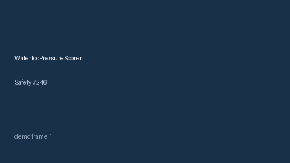

# WaterlooPressureScorer Guide



Research-only advisory scorer. Gap vs MDCalc / Waterloo pressure-injury risk screen.
Distinct from `BradenPressureScorer` / `MorseFallScorer`. Safety #246.

Narrative polish via **GPT-6 Astra / Claude Opus 5.5 / Gemini 4 Argon / Kimi K3.1 Pro**.

## Usage

```python
from medagent.safety.waterloo_pressure_scorer import WaterlooPressureFactors, WaterlooPressureScorer

findings = WaterlooPressureScorer().check(WaterlooPressureFactors())
print(findings[0].band, findings[0].rationale)
```

## Safety

RESEARCH USE ONLY. Never modifies medications. No network I/O.
