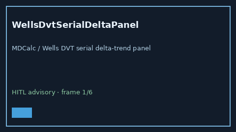

# WellsDvtSerialDeltaPanel Guide



Research-only advisory panel (Safety #265).
Gap vs MDCalc / Wells DVT serial delta-trend panel. Distinct from `WellsDvtProbabilityScorer` / `WellsPeSerialDeltaPanel`.

Stack: **GPT-5.5 / Claude Sonnet 4.6 / Gemini 3.x / Kimi K2**.

## Usage

```python
from medagent.safety.wells_dvt_serial_delta_panel import (
    WellsDvtSerialDeltaFactors,
    WellsDvtSerialDeltaPanel,
)

findings = WellsDvtSerialDeltaPanel().check(
    WellsDvtSerialDeltaFactors(
        prior_wells_dvt_elevated=0,
        current_wells_dvt_rise=0,
    )
)
assert findings[0].rationale
```

## Safety

RESEARCH USE ONLY. Advisory only. No network I/O. Never modifies medications.
