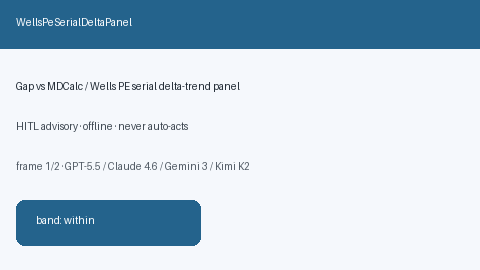

# WellsPeSerialDeltaPanel Guide



Research-only advisory panel. Gap vs MDCalc / Wells PE serial delta-trend panel.
Distinct from `WellsPeProbabilityScorer` / `PsiPortPneumoniaScorer`.

Narrative polish via **GPT-5.5 / Claude Sonnet 4.6 / Gemini 3.x / Kimi K2**.

## Usage

```python
from medagent.safety.wells_pe_serial_delta_panel import (
    WellsPeSerialDeltaFactors,
    WellsPeSerialDeltaPanel,
)

findings = WellsPeSerialDeltaPanel().check(WellsPeSerialDeltaFactors())
assert findings[0].rationale
```

## Safety

RESEARCH USE ONLY. Advisory. Never modifies medications. No network I/O.
